 

 

<table>
<tr>
<td width="50%" valign="top">

### 🧭 Now
- Building perception pipelines for manipulation and mobile robots
- Exploring **robot learning** (RL and imitation) in simulation
- Making everything I learn into **free YouTube lessons**

### 🧠 Focus
- **Robotics:** ROS 2, navigation, motion planning, control
- **Computer Vision:** detection, segmentation, SLAM, 3D geometry
- **ML/DL:** PyTorch, reinforcement learning, model evaluation

</td>
<td width="50%" valign="top">

### 🛠 Stack

  
  
  
  
  
  
  
  

### 📡 Find me

  
  
  

</td>
</tr>
</table>

---

### 📊 GitHub at a glance

  
  

---

### 🚀 Featured work

| Project | What it does | Stack |
|---|---|---|
| [**youtube-kaynak-kodlari**](https://github.com/emreyoleridev/youtube-kaynak-kodlari) | Source code for every lesson, one folder per episode | Python · NumPy · Pandas |
| *Coming soon* | Robot perception demo: detect → estimate pose → grasp | ROS 2 · OpenCV · PyTorch |
| *Coming soon* | Reinforcement learning agent in simulation | Gymnasium · PyTorch |

---

### 🤝 Open to
Collaboration on robotics and ML projects, open-source contributions, and conversations about learning robotics the hard way (with code).

 

